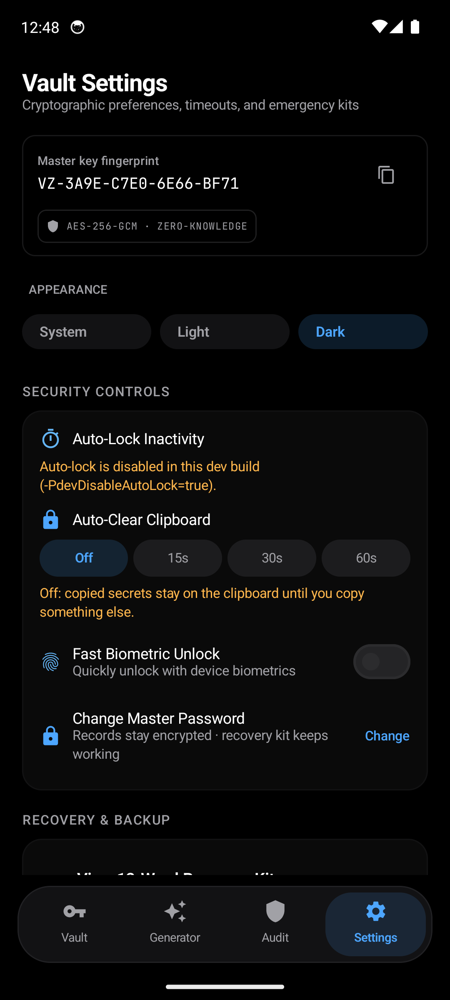
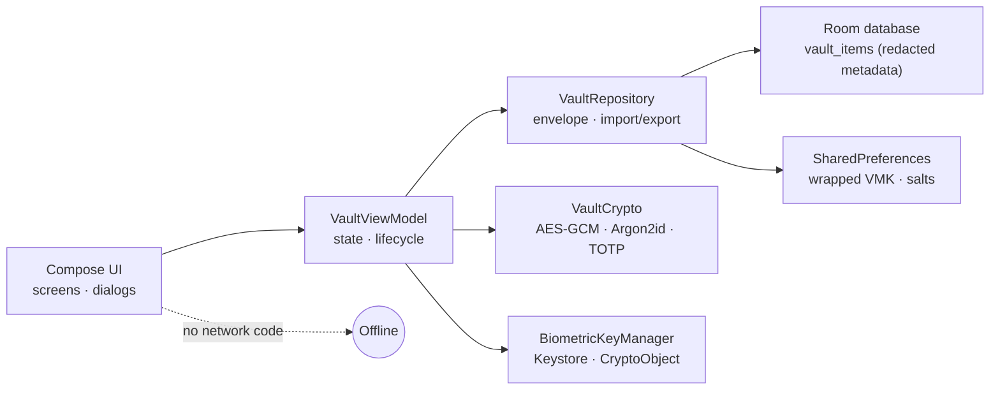

<div align="center">


# VaultZero

**Offline, zero-knowledge password manager and encrypted vault for Android.**

AES-256-GCM · Argon2id (64 MiB, t=3) · English/Spanish · BIP-39 128-bit recovery kits · hardware biometrics · no network permission · no accounts · no telemetry

🌐 [cipherwell.github.io/Vault-Zero](https://cipherwell.github.io/Vault-Zero/) · 📦 [GitHub Releases](https://github.com/cipherwell/Vault-Zero/releases) · 📚 [Documentation](docs/README.md)

[](https://github.com/cipherwell/Vault-Zero/releases/latest)
[](LICENSE)
[](https://github.com/cipherwell/Vault-Zero/actions/workflows/test.yml)
[](https://github.com/cipherwell/Vault-Zero/actions/workflows/reproducibility.yml)
[-3DDC84?style=flat-square&logo=android&logoColor=white)](#requirements)
[](#tech-stack)
[](#security-at-a-glance)

</div>

---

## What is VaultZero?

VaultZero is a local-first Android vault for passwords, 2FA codes, payment cards, API keys,
crypto wallets/seed phrases, secure notes and identity documents. It is built with Kotlin and
Jetpack Compose and is deliberately incapable of connecting to the internet: the app declares
**no `INTERNET` permission** and contains no networking code.

Everything is encrypted on the device with a random 256-bit vault key, wrapped by your master
password and a 12-word recovery phrase. Backups are encrypted files written through Android's
system file picker — there is no account, cloud sync, analytics or remote service.

> **Status:** **v1.7.7** (`versionCode 16`, package `com.cipherwell.vaultzero`). Self-tested and pentested; an
> independent audit is still recommended before relying on it for high-risk secrets.

## Table of contents

- [Screenshots](#screenshots)
- [Features](#features)
- [Security at a glance](#security-at-a-glance)
- [Download & install](#download--install)
- [Build from source](#build-from-source)
- [Testing](#testing)
- [Architecture](#architecture)
- [Repository map](#repository-map)
- [Documentation](#documentation)
- [Privacy](#privacy)
- [Contributing](#contributing)
- [License](#license)

## Screenshots

| Vault (dark) | Light theme | 2FA dashboard |
| :---: | :---: | :---: |
|  |  |  |
| **Settings** | **Generator** | **Audit** |
|  |  |  |

More in [docs/SCREENSHOTS.md](docs/SCREENSHOTS.md).

## Features

### Vault
- Six record types: **Logins**, **Payment cards**, **API secrets**, **Crypto wallets**, **Secure notes**, **Identities**.
- AES-256-GCM per-record encryption with AAD binding; titles, categories and tags are encrypted too — SQLite only stores `[ENCRYPTED]` placeholders.
- Live RFC 6238 TOTP codes (30 s) inline in the list and in a dedicated **2FA dashboard**.
- Search operators: `type:login`, `tag:work`, `is:fav`, and audit-backed filters `is:weak`, `is:reused`, `is:stale`, `is:no2fa`, `is:clean`.
- Sort by favourites, title, recently updated or recently used; optional grouping by type; multi-select bulk delete/favourite; undo delete.
- Copy actions are sensitive-clipboard aware; revealed secrets re-mask after 15 seconds.

### Security
- Random 256-bit vault master key (VMK); per-record AES-256-GCM with `VaultZero_Record_v2:<id>:<type>` AAD.
- **Argon2id** (RFC 9106: 64 MiB, 3 iterations, 1 lane) with 128-bit random salts for every new key
  envelope. Vaults and backups still using PBKDF2-HMAC-SHA256 (600,000) open normally and are
  transparently migrated to Argon2id on the next successful unlock.
- **Bilingual English (US) / Spanish (US):** every screen, dialog and error is translated, with the
  language switch available on the lock screen before the first vault exists and in Settings. The
  choice applies instantly and is stored outside the vault data.
- **BIP-39 128-bit recovery kit** (2048-word standard, unique words); change master password without re-encrypting records; rotate an exposed kit without changing the vault.
- Hardware-backed biometric unlock through Android Keystore + `BiometricPrompt.CryptoObject` — **per-use** authentication, invalidated when biometrics are re-enrolled. The prompt auto-appears on app open when enabled.
- Configurable auto-lock, background lock (screen-off locks immediately; SAF picker exempt), clipboard auto-clear, `FLAG_SECURE`, Recent-Apps preview blocked.
- Local security audit (weak/reused/stale/2FA), offline by construction.

### Backups
- **First-run migration:** a new phone can restore a full backup with the existing 12-word recovery
  phrase — no new seed phrase — keeping the original master password (or setting a new one).
- Versioned encrypted envelope via Android's Storage Access Framework only.
- Restore with the source master password **or** 12-word recovery phrase; optional **phrase-only** export (password envelope stripped).
- Verified imports before any write: duplicate-safe merges, in-place updates, atomic Room transaction, explicit salvage of readable records from a damaged file.
- Timestamped filenames; import/export progress feedback.

### Design & ergonomics
- One UI-inspired design: true-black/`#FAFAFA` grounds, single accent blue, squircle containers, floating pill navigation, large collapsing title.
- Light / dark / system appearance; launcher shortcuts (*New login*, *Generator*); passphrase separator/capitalisation options.

## Security at a glance

| Area | Implementation |
| --- | --- |
| Records | AES-256-GCM, random per-record IV, 128-bit tag, AAD bound to record id + type |
| Key hierarchy | Random 256-bit VMK wraps records; VMK wrapped by password KEK and recovery-phrase KEK |
| Password KDF | Argon2id, m=64 MiB, t=3, p=1, 128-bit random salt (PBKDF2-HMAC-SHA256 600k accepted and migrated) |
| Recovery | BIP-39 12-word phrase (128-bit entropy) with unique words; legacy v1.x phrases still accepted; encrypted under the VMK at rest; rotatable in Settings |
| Biometrics | AES-256-GCM Keystore key, `AUTH_BIOMETRIC_STRONG`, per-use auth (`CryptoObject`), StrongBox→TEE, invalidated by biometric enrolment changes |
| Backups | AES-256-GCM envelope, redacted metadata, 8 MiB import cap, phrase/password restore |
| Network | No `INTERNET`/`ACCESS_NETWORK_STATE` permission, no networking libraries |
| Screen capture | `FLAG_SECURE`, recents screenshot disabled on API 33+ |
| At rest | SQLite titles/categories/tags redacted; prefs contain only wrapped keys, salts, verifiers |
| Offline | No accounts, cloud, analytics, crash reporting, ads or trackers |

Detailed design: [docs/CRYPTO-SPEC.md](docs/CRYPTO-SPEC.md) · controls & evidence:
[SECURITY.md](SECURITY.md) · threat model: [docs/THREAT-MODEL.md](docs/THREAT-MODEL.md).

## Download & install

Latest release: **[GitHub Releases → v1.7.7](https://github.com/cipherwell/Vault-Zero/releases/latest)**

| Artifact | Size | SHA-256 |
| --- | --- | --- |
| `VaultZero-v1.7.7.apk` (sideload) | 2,176,705 B | `2ef78918dce040c006610f8877ba3261af37218263782fb414ebf0c3f4b60bff` |

Beta tester? Read [docs/BETA.md](docs/BETA.md) first — test data only, and how to verify the APK.

Prefer store-like updates without Google? Add the self-hosted F-Droid repository
`https://cipherwell.github.io/Vault-Zero/fdroid/repo` in F-Droid/Neo Store/Droid-ify (fingerprint
`BC:CC:45:55:…:F9:49`, details in [docs/DISTRIBUTION.md](docs/DISTRIBUTION.md)).

Signing certificate (production upload key, APK Signature Scheme v2):
`6292a1fc630c200e7ec5342248ba7a6ae30a893fd882b2ad4188f699bbb607e7`

```bash
sha256sum -c VaultZero-v1.5.0.apk.sha256
apksigner verify --print-certs VaultZero-v1.5.0.apk
```

See [docs/GETTING-STARTED.md](docs/GETTING-STARTED.md) for installation and first-run steps.

> **Upgrading from any earlier release:** v1.5.0 is a new Android package
> (`com.cipherwell.vaultzero`). Export an encrypted backup + recovery phrase, install v1.5.0, restore
> on first run, verify, then uninstall the old package. Earlier GitHub releases/assets were removed
> during the identity migration.

### Requirements
Android 7.0 (API 24) or newer. No Google Play Services, no network, no account.

## Build from source

Prerequisites: **JDK 17**, Android SDK **36**, Gradle wrapper included.

```bash
git clone https://github.com/cipherwell/Vault-Zero.git
cd Vault-Zero
export JAVA_HOME=/usr/lib/jvm/java-17-openjdk   # or your JDK 17
export ANDROID_HOME=$HOME/Android/Sdk
./gradlew :app:assembleDebug                     # install with adb install -r app/build/outputs/apk/debug/app-debug.apk
```

Debug builds normally enable `FLAG_SECURE`; for emulator UI automation only:
`./gradlew :app:assembleDebug -PallowScreenshots=true -PdevDisableAutoLock=true`.

Production/release builds require the keystore environment (`docs/RELEASING.md`). Full
instructions: [docs/BUILDING.md](docs/BUILDING.md).

## Testing

```bash
./gradlew :app:testDebugUnitTest       # 119 JVM/Robolectric tests
./gradlew :app:lintDebug               # Android Lint
```

There are 12 instrumented device tests too (biometric key binding, KDF migration, offline posture,
setup flow). Because `connectedAndroidTest` uninstalls the app, device tests are run manually —
see [docs/TESTING.md](docs/TESTING.md) for commands and the QA checklist.

## Architecture



Single-activity Compose app; all secrets are decrypted only into memory while the vault is
unlocked. Details: [docs/ARCHITECTURE.md](docs/ARCHITECTURE.md) · crypto:
[docs/CRYPTO-SPEC.md](docs/CRYPTO-SPEC.md).

## Repository map

```
vault-zero-app/
├── app/                       Android application module (Kotlin/Compose)
│   └── src/main/java/com/example/
│       ├── crypto/            AES-GCM, Argon2id/PBKDF2, TOTP, biometric keystore, audit engine
│       ├── data/              Room database, repository, preferences, backup IO
│       ├── model/             Vault records, payloads, audit models
│       └── ui/                Compose screens, components, theme, backup picker
├── docs/                      Documentation (start at docs/README.md)
│   └── screenshots/           Curated screenshots (+ archive/)
├── releases/                  Release notes & checksums (binaries on GitHub Releases)
├── store/                     listing assets (F-Droid/fastlane; Play pack archived)
├── fastlane/                  F-Droid metadata (listing, changelog, images)
├── fdroid/                    F-Droid build recipe
├── .github/                   Issue/PR templates, release workflow, Dependabot
├── SECURITY.md                Security policy, evidence and residual risks
├── CHANGELOG.md               Version history
├── CONTRIBUTING.md            Contribution guide
└── LICENSE                    MIT
```

Full annotated tree: [docs/REPO-MAP.md](docs/REPO-MAP.md).

## Documentation

| Document | What it covers |
| --- | --- |
| [docs/README.md](docs/README.md) | Documentation index & reading paths |
| [docs/GETTING-STARTED.md](docs/GETTING-STARTED.md) | Install, first vault, recovery kit, biometrics, backups |
| [docs/FEATURES.md](docs/FEATURES.md) | Complete user guide and search syntax |
| [SECURITY.md](SECURITY.md) | Security controls, verification, limitations, disclosure |
| [docs/CRYPTO-SPEC.md](docs/CRYPTO-SPEC.md) | Algorithms, key hierarchy, record/backup formats |
| [docs/THREAT-MODEL.md](docs/THREAT-MODEL.md) | Adversaries, assets, mitigations, residual risk |
| [docs/ARCHITECTURE.md](docs/ARCHITECTURE.md) | Stack, layers, data flow, database schema |
| [docs/BACKUP-FORMAT.md](docs/BACKUP-FORMAT.md) | Envelope schema, import/export semantics |
| [docs/BUILDING.md](docs/BUILDING.md) | Build, dev flags, device tests |
| [docs/TESTING.md](docs/TESTING.md) | Test matrix, commands, manual QA |
| [docs/AUDIT-2026-11-15-recovery-and-encryption.md](docs/AUDIT-2026-11-15-recovery-and-encryption.md) | Recovery-phrase/encryption audit and fixes |
| [docs/RELEASING.md](docs/RELEASING.md) | Signing, versioning, GitHub/F-Droid release |
| [docs/DISTRIBUTION.md](docs/DISTRIBUTION.md) | Install/update without Google: GitHub, Obtainium, F-Droid |
| [docs/DESIGN.md](docs/DESIGN.md) | One UI-inspired design tokens & screens |
| [docs/PENTEST-2026-11-15.md](docs/PENTEST-2026-11-15.md) | Self-directed security assessment |
| [docs/FAQ.md](docs/FAQ.md) | Frequently asked questions |
| [docs/TROUBLESHOOTING.md](docs/TROUBLESHOOTING.md) | Common problems & fixes |
| [docs/PRIVACY.md](docs/PRIVACY.md) | Privacy policy |
| [releases/](releases/README.md) | Release notes, checksums, verification |
| [store/](store/README.md) | Listing assets & answers (Play pack archived, not used) |

## Privacy

VaultZero collects no data and has no network permission. The only thing that leaves the
device is an encrypted backup you explicitly export. Full policy:
[docs/PRIVACY.md](docs/PRIVACY.md) · [web version](docs/privacy.html).

## Contributing

Security tool: changes that weaken cryptography, add network access, log secrets or relax
storage rules are rejected. Read [CONTRIBUTING.md](CONTRIBUTING.md) and
[docs/THREAT-MODEL.md](docs/THREAT-MODEL.md) before opening a PR. For vulnerabilities use
GitHub's private advisory flow (see [SECURITY.md](SECURITY.md)); do not file a public issue.

## License

MIT — see [LICENSE](LICENSE). VaultZero is an independent, local-first tool. You are responsible
for your device security, master password strength and backups; no software can recover a
forgotten master password and recovery phrase.

<div align="center"><sub>Built by Cipherwell · Not affiliated with Samsung, Google or Android.</sub></div>
