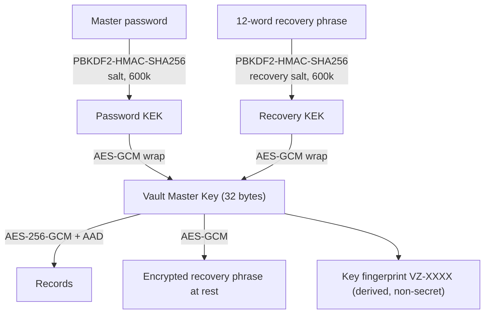

# Cryptographic design

This document is the implementation reference for VaultZero `1.1.0`. It describes what the code
actually does; source of truth is `app/src/main/java/com/example/crypto/` and
`app/src/main/java/com/example/data/VaultRepository.kt`.

## Parameters

| Parameter | Value |
| --- | --- |
| Record cipher | AES-256-GCM |
| GCM IV | 12 bytes, random per encryption (`SecureRandom`) |
| GCM tag | 128 bits |
| Vault master key (VMK) | 32 random bytes (`SecureRandom`) |
| Password KDF | PBKDF2WithHmacSHA256 |
| Default/current iterations | 600,000 |
| Minimum accepted iterations (legacy import) | 10,000 |
| KDF salt | 16 random bytes, stored base64 |
| Verifier | HMAC-SHA256 over a domain-separated message, never a bare password hash |
| Recovery phrase | 12 words from a fixed list + SHA-256 checksum word |
| TOTP | RFC 6238, HMAC-SHA1, 6 digits, 30-second time step |
| Backup envelope version | `3.2` (`VaultZero_Encrypted_Envelope`) |
| Base64 | `Base64.NO_WRAP` for IV/ciphertext/envelope concatenation |

## Key hierarchy



The VMK is wrapped independently by both KEKs, so either the master password or the recovery
phrase can unwrap it. Changing the master password rewrites only the password envelope; the VMK,
records and recovery envelope are untouched.

## Setup

1. Generate a 32-byte VMK and store only in memory after setup.
2. Generate a 16-byte password salt; derive the password KEK; wrap the VMK with AES-GCM.
3. Generate a 12-word recovery phrase; derive the recovery KEK from the normalized phrase; wrap the
   VMK independently.
4. Encrypt the recovery phrase under the VMK so it is never stored in plaintext; store only its
   verifier separately.
5. Derive a key fingerprint from the VMK (public identifier shown on the lock screen; not a secret).
6. Atomically persist: password verifier, password salt, recovery salt, wrapped VMKs, encrypted
   recovery phrase, recovery verifier, fingerprint, iterations.

## Record encryption

The record plaintext is a JSON envelope (`_vz_meta_v2`) containing `id`, `type`, `title`,
`category`, `tags` and the typed `payload`. It is encrypted with the VMK using AES-GCM and the
AAD:

```
VaultZero_Record_v2:<record-id>:<record-type>
```

Stored value is `base64(iv || ciphertext || tag)`. The SQLite columns `title`/`category`/`tagsJson`
store `[ENCRYPTED]`/`Encrypted`/`[]`. Because the AAD is bound to id and type, swapping two rows'
ciphertexts makes both fail authentication; the app hides failed records rather than displaying
garbage. Legacy v1 records without AAD are still readable and are re-encrypted in v2 format on the
next save.

## Unlock and verification

- Unlock derives the password KEK from the stored salt and iteration count, decrypts the wrapped
  VMK, and compares a domain-separated verifier before accepting the password.
- Five failed attempts initiate a 30 s lockout; the check happens before PBKDF2 to avoid abuse.
- Legacy 100k-iteration vaults are transparently re-wrapped with fresh salts at 600k on a
  successful unlock (VMK unchanged; atomic preference write).
- Recovery uses the normalized 12-word phrase, validates the checksum word, derives the recovery
  KEK and unwraps the same VMK. The phrase can be used to set a new master password.

## Biometric key

- Algorithm: AES-256-GCM in Android Keystore (StrongBox attempted; TEE fallback).
- `setUserAuthenticationRequired(true)`, `AUTH_BIOMETRIC_STRONG`, 0-second validity
  (per-operation) on API 30+; `-1` validity on older versions.
- `setInvalidatedByBiometricEnrollment(true)`, `setUnlockedDeviceRequired(true)` where supported.
- The wrapped VMK is stored only after an authenticated `ENCRYPT_MODE` cipher from
  `BiometricPrompt.CryptoObject`; unlock passes an authenticated `DECRYPT_MODE` cipher.
- There is no fallback decrypt path: no authorised cipher ⇒ no VMK. Re-enrolment invalidates the
  key and the app clears the wrapped value, requiring re-enable with the master password.

## Backups

Exports are JSON envelopes whose contents are encrypted with the VMK/KEKs; the item payloads are
the same AES-GCM records as in SQLite. Import supports the source master password or the source
recovery phrase. Format and semantics: [BACKUP-FORMAT.md](BACKUP-FORMAT.md).

## Password and passphrase generation

- Passwords use `SecureRandom` over selected character classes, optional ambiguous-character
  filtering, length 4–128 (UI 8–64), and report entropy estimates (not a guarantee).
- Passphrases pick words uniformly from the bundled word list (3–8 words), optional capitalisation
  and separator. No network, no dictionary API.

## TOTP

- Standard RFC 6238 HMAC-SHA1 with a 30-second step and 6 digits; secrets must decode as base32
  and meet a minimum byte length before a code is shown.
- Codes are computed on demand from decrypted secrets; they are never persisted. Copying uses the
  sensitive-clipboard path.

## What is not secret / visible in backups

Visible by design (not usable without a credential): format/version markers, KDF iteration count,
salts, public KDF parameters, key fingerprint, wrapped key envelopes, item ids/types, timestamps,
favourite flags, ciphertext size. Titles/categories/tags/secrets are *inside* the ciphertext.

## Memory handling and limitations

- Derived byte arrays and keys are cleared where practical; strings (master password input, field
  values) cannot be wiped from the JVM heap. See [SECURITY.md](../SECURITY.md#known-limitations--residual-risks).
- The `BiometricPrompt` may briefly show system UI; the app itself never receives biometric data.
- Recovery depends on either the master password or the 12-word phrase; there is no escrow.
