# Screenshots

Current screenshots of release `1.1.0` (Android 14 emulator, dark/light themes). They are used in
the README and Play/F-Droid listings. Files live in `screenshots/`; legacy sets are under
`screenshots/archive/`.

## Vault

| Dark | Light |
| :---: | :---: |
| 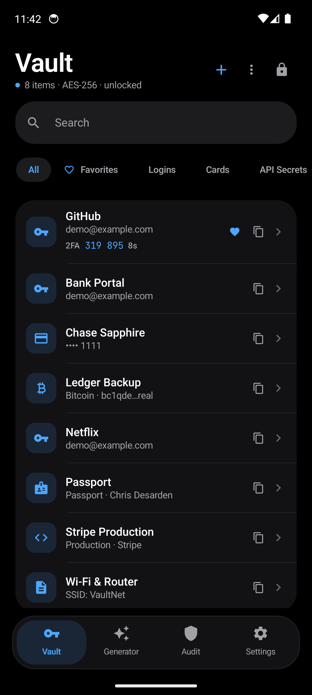 | 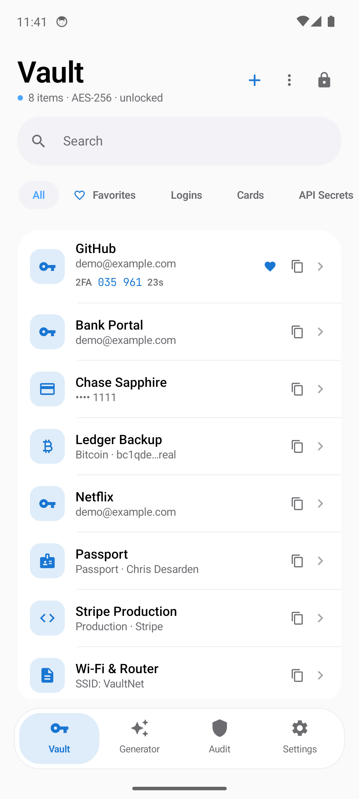 |

## 2FA dashboard / grouped list

| 2FA codes | Grouped + collapsed title |
| :---: | :---: |
| 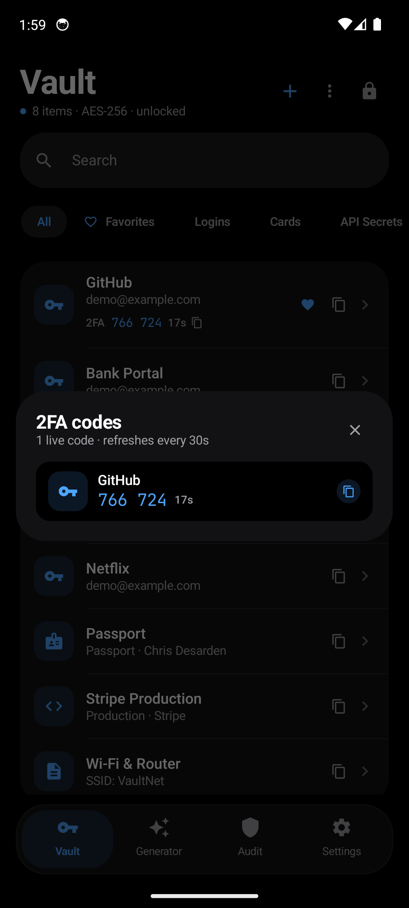 | 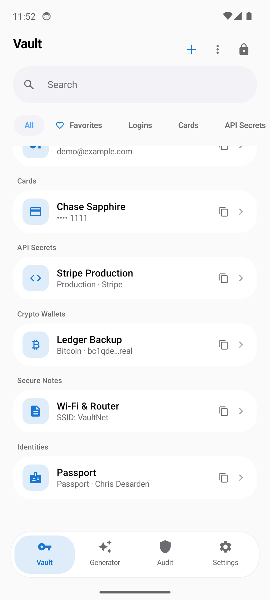 |

## Generator / Audit

| Generator | Audit |
| :---: | :---: |
| 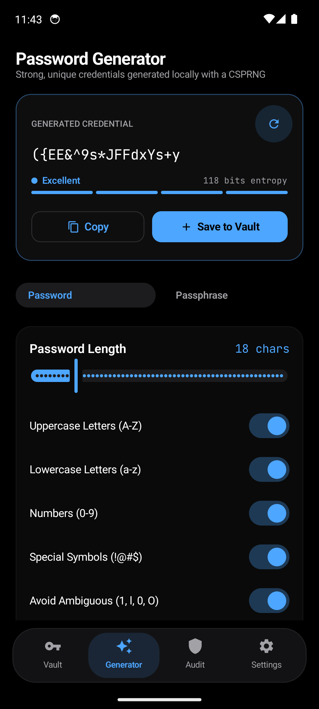 | 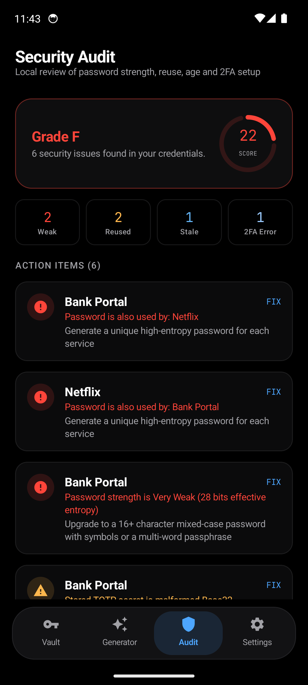 |

## Settings

| Security controls | Recovery & backup |
| :---: | :---: |
| 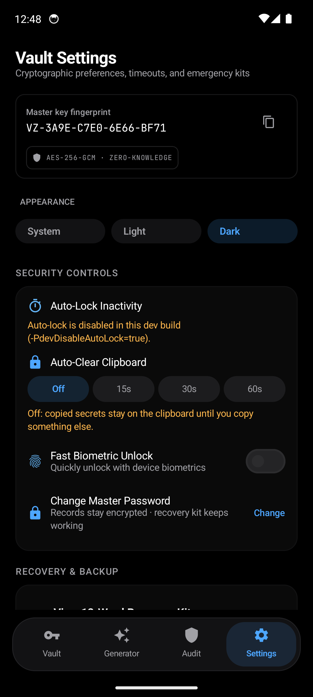 | 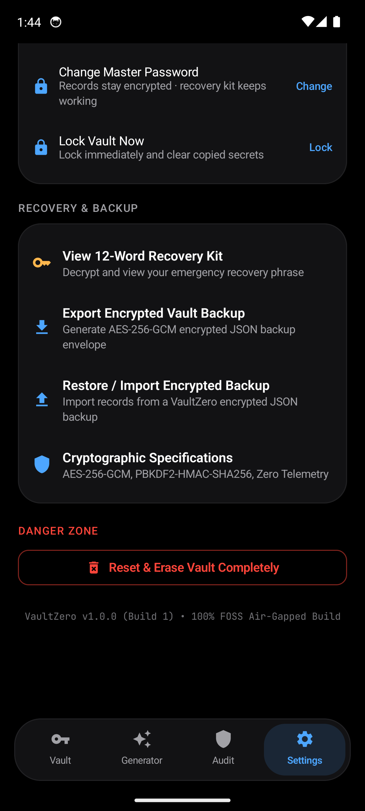 |

## Detail / editor / dialogs

| Detail sheet | Unsaved-changes guard |
| :---: | :---: |
| 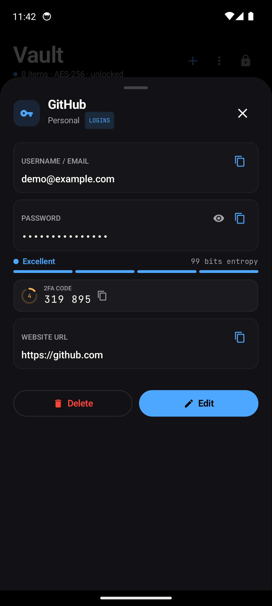 | 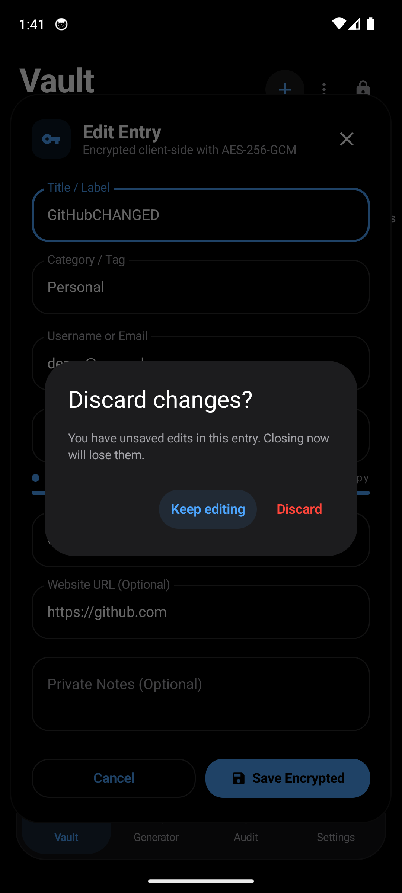 |
| **Change master password** | **Export protection** |
| 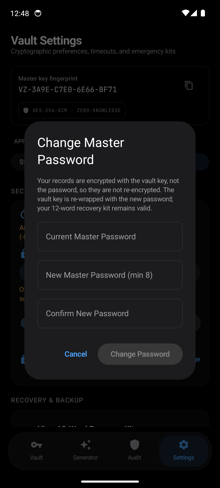 | 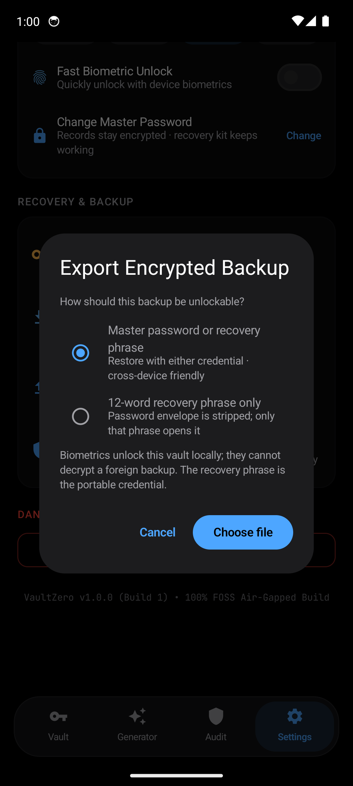 |

## Other current captures

`screenshots/oneui-search-audit.png`, `oneui-editor-light.png`, `oneui-grouped-light.png`,
`oneui-lock-dark.png`, `oneui-settings-dark.png`, `oneui-settings-light.png`.

## Archive

`screenshots/archive/` contains historical captures (pre-One UI redesign, earlier feature demos)
kept for changelog context. They do not represent the current UI.

## Updating screenshots

Automation-friendly debug build:

```bash
./gradlew :app:assembleDebug -PallowScreenshots=true -PdevDisableAutoLock=true
adb install -r app/build/outputs/apk/debug/app-debug.apk
# navigate, then:
adb exec-out screencap -p > docs/screenshots/oneui-<screen>.png
```

Never ship builds made with those flags. Production builds intentionally block capture.
