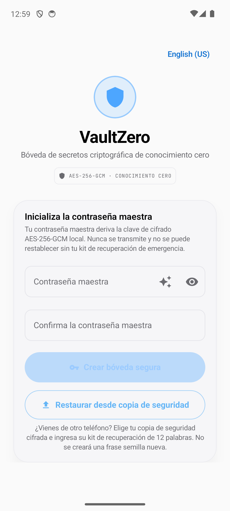
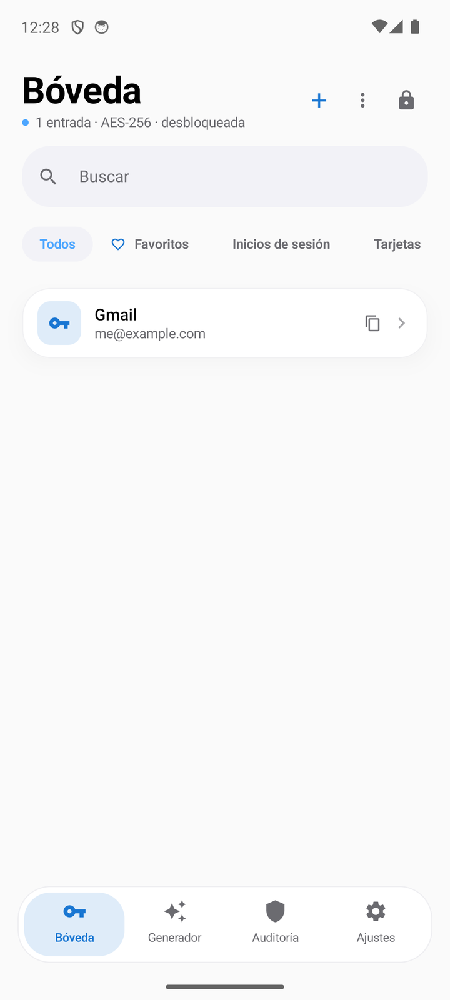
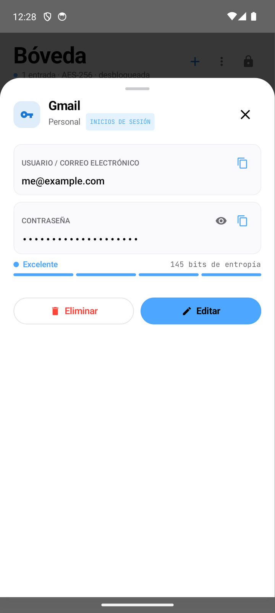
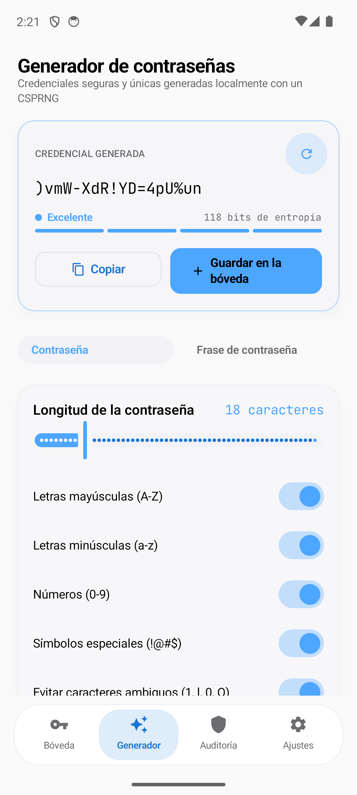
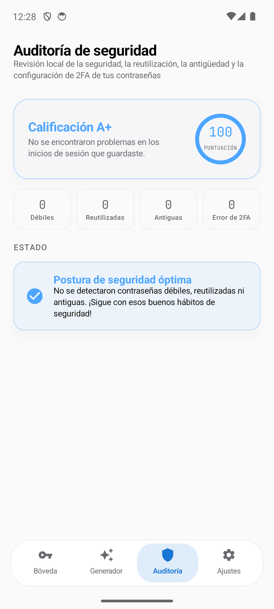
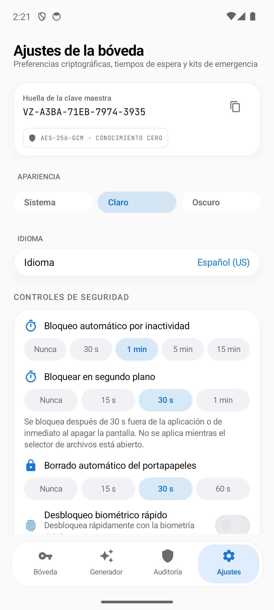
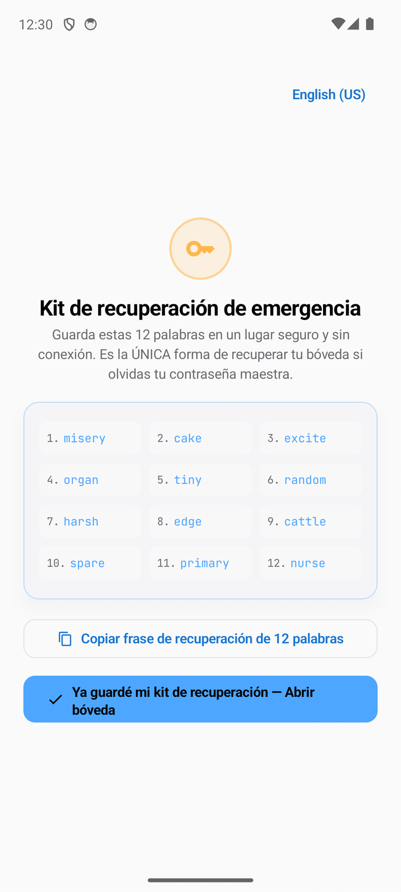
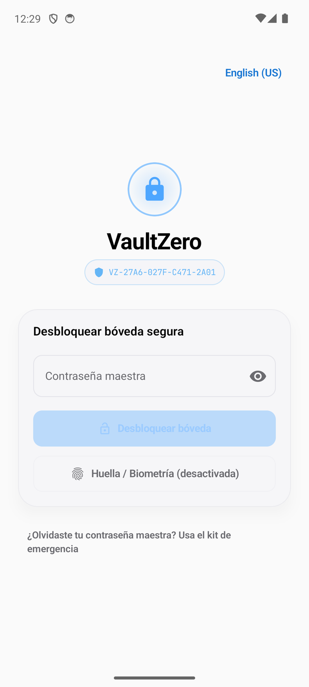

# VaultZero — tu bóveda privada

**Guía del usuario beta · v1.7.15 · noviembre de 2026**

VaultZero es una bóveda de contraseñas para Android que funciona **sin conexión**. Guarda tus
inicios de sesión, tarjetas, notas y códigos de recuperación cifrados en tu teléfono, **sin cuenta, sin
nube y sin permiso de internet**.

Esta guía explica cada función en lenguaje sencillo, cómo funciona la seguridad y qué debes hacer (y
qué evitar) para mantener tu bóveda protegida.

---

## Contenido

1. Qué es VaultZero
2. La versión de 60 segundos
3. Qué hay dentro de la app
4. Cómo usar cada función
5. Cómo funciona la seguridad
6. Qué la hace diferente
7. De qué protege — y de qué no
8. Copias de seguridad y cambio de teléfono
9. Instalar, actualizar y verificar
10. Notas de la beta y auditoría de seguridad
11. Preguntas frecuentes
12. Palabras explicadas de forma sencilla

---

## 1. Qué es VaultZero

VaultZero es un lugar pequeño y privado para los secretos que sostienen tu vida digital:

- contraseñas y nombres de usuario,
- tarjetas de crédito y débito,
- claves y tokens de API,
- frases semilla y claves privadas de billeteras cripto,
- notas seguras,
- documentos de identidad.

Todo se cifra **en tu dispositivo, antes de guardarse**. No hay un servidor de la empresa al que
entrar, no hay cuenta que crear y no hay un correo de "olvidé mi contraseña" que pueda interceptarse.

Tu **contraseña maestra** es la única llave de la bóveda. Nunca se guarda, nunca se envía a ningún
lugar y nadie puede recuperarla —ni siquiera los desarrolladores. Por eso la app te entrega un **kit de
recuperación de 12 palabras** al configurarla. Guárdalo sin conexión y en un lugar seguro.

> **La única regla:** si pierdes la contraseña maestra **y** el kit de recuperación, la bóveda se
> pierde. Nadie puede restablecerla por ti. Ese es el precio de la privacidad real.

---

## 2. La versión de 60 segundos

1. **Instala** VaultZero desde GitHub Releases, Obtainium o el repositorio F-Droid del proyecto.
2. **Crea la bóveda:** elige una contraseña maestra larga (12 caracteres o más es una buena meta) y
   confírmala.
3. **Guarda el kit de recuperación:** escribe las 12 palabras en papel, en orden. No lo fotografíes ni
   lo guardes en otra app de contraseñas. Ten dos copias en dos lugares seguros.
4. **Abre la bóveda** y agrega tu primer inicio de sesión con el botón **+**.
5. **Activa el bloqueo automático** y, si quieres, el **desbloqueo biométrico** en Ajustes.

Eso es todo. El resto de la guía es detalle.



---

## 3. Qué hay dentro de la app

La app tiene cuatro pestañas en la parte inferior:

| Pestaña | Para qué sirve |
| --- | --- |
| **Bóveda** | Tus registros: inicios de sesión, tarjetas, secretos de API, billeteras, notas e identidades |
| **Generador** | Crea contraseñas y frases de contraseña fuertes en el dispositivo |
| **Auditoría** | Revisa tus inicios de sesión por contraseñas débiles, repetidas o antiguas y 2FA roto |
| **Ajustes** | Seguridad, apariencia, idioma, recuperación, copias de seguridad y borrado |



### Los seis tipos de registro

Cuando tocas **+ → eliges un tipo**, aparece un formulario adaptado a ese secreto:

| Tipo | Úsalo para | Campos que puedes guardar |
| --- | --- | --- |
| **Inicio de sesión** | Sitios web y apps | Usuario/correo, contraseña, sitio web, secreto 2FA, notas privadas |
| **Tarjeta** | Tarjetas de crédito y débito | Titular, número, vencimiento, CVV, PIN del cajero, marca |
| **Secreto de API** | Claves y tokens de desarrollador | Servicio, clave de API, token secreto, entorno, permisos, endpoint |
| **Billetera cripto** | Billeteras y frases semilla | Nombre, red, dirección pública, frase semilla, clave privada, ruta de derivación |
| **Nota segura** | Cualquier cosa privada | Una nota cifrada |
| **Identidad** | Pasaportes, identificaciones, documentos legales | Nombre completo, tipo y número de documento, fecha de nacimiento, vencimiento |

Cada registro también tiene un **título**, una **categoría** (por ejemplo Personal o Trabajo) y
**etiquetas** opcionales.

---

## 4. Cómo usar cada función

### Agregar, editar y eliminar un registro

- **Agregar:** toca **+**, elige un tipo, completa los campos y pulsa **Guardar cifrado**.
- **Editar:** abre el registro y toca **Editar**.
- **Eliminar:** abre el registro y toca **Eliminar**, o mantén pulsado un registro en la lista para
  seleccionar varios. Una eliminación se puede **deshacer** durante unos segundos —busca la barra de
  deshacer en la parte inferior.



### Copiar una contraseña o un usuario

Toca el icono de copiar junto al campo. La app lo copia, muestra una confirmación breve y **limpia el
portapapeles automáticamente** después del tiempo que elijas en Ajustes (o cuando la bóveda se bloquea,
si pusiste el temporizador en Apagado). La copia se marca como "sensible" para que Android la oculte
en las vistas previas del portapapeles en versiones nuevas.

### Búsqueda, filtros y favoritos

- La **búsqueda** revisa títulos, usuarios, URLs y categorías.
- Los **filtros** de arriba cambian entre Todo, Favoritos, Inicios de sesión, Tarjetas, Secretos de
  API, Billeteras cripto, Notas e Identidades.
- Marca cualquier registro con la **★** para añadirlo a Favoritos; puedes ordenarlos para que
  aparezcan primero.
- El menú **⋮** ofrece orden (título, recientes, usados recientemente) y **agrupar por tipo**.

### Seleccionar varios registros

Mantén pulsado un registro para empezar la selección. Toca más registros para añadirlos y usa la barra
superior para eliminar la selección o marcarla como favorita. Toca la X para salir de la selección.

### Generador de contraseñas

Abre la pestaña **Generador**:

- **Modo contraseña:** elige la longitud y qué caracteres usar (mayúsculas, minúsculas, números,
  símbolos); puedes evitar caracteres que se confunden (I, l, 0, O).
- **Modo frase:** elige cuántas palabras y el separador; puedes capitalizar.
- Pulsa **Copiar**, **regenerar** o **Guardar en la bóveda** para crear un inicio de sesión en un paso.

El generador usa el generador seguro de números aleatorios del teléfono. El **historial de la sesión**
muestra lo generado en esta sesión: vive solo en memoria y desaparece cuando la bóveda se bloquea.



### Códigos de dos factores (2FA/TOTP)

Si un sitio te da una "clave de configuración" (un código Base32) para la verificación en dos pasos,
pégala en el campo **2FA** de ese inicio de sesión. VaultZero mostrará un **código de 6 dígitos que
cambia cada 30 segundos** y podrás copiarlo con un toque. Los códigos se generan en el dispositivo;
nunca viajan por internet.

El chip **2FA** en la parte superior de la bóveda abre un panel con todos tus códigos actuales.

### Revisión de seguridad (Auditoría)

La pestaña **Auditoría** revisa solo tus **inicios de sesión** y te da una puntuación y una nota:

| Revisión | Qué significa |
| --- | --- |
| **Débil** | La contraseña es corta o tiene poca entropía efectiva |
| **Repetida** | La misma contraseña se usa en más de un inicio de sesión |
| **Antigua** | El registro no se actualiza desde hace más de 90 días |
| **Error de 2FA** | Se escribió un secreto 2FA que no es Base32 válido |

La puntuación empieza en 100 y baja con cada problema. Las notas son **A+ / A / B / C / F**. Cada
problema tiene una acción **Corregir** que abre el registro para generar y guardar una contraseña más
fuerte y única.



### Ajustes, fila por fila



| Ajuste | Qué hace |
| --- | --- |
| **Huella de la clave maestra** | Una huella pública corta de esta bóveda. Se puede compartir con soporte; no revela la clave. |
| **Apariencia** | Tema Sistema, Claro u Oscuro. |
| **Idioma** | Inglés o español, independiente del idioma del teléfono. |
| **Bloqueo automático por inactividad** | Bloquea tras 30 s, 1, 5 o 15 minutos sin interacción. |
| **Bloquear en segundo plano** | Bloquea 15 s, 30 s o 1 minuto después de salir de la app; también al apagar la pantalla. |
| **Borrado automático del portapapeles** | Limpia los secretos copiados tras 15, 30 o 60 segundos, o al bloquear si está en Apagado. |
| **Desbloqueo biométrico rápido** | Desbloquea con huella o rostro en lugar de escribir la contraseña maestra. |
| **Cambiar contraseña maestra** | Vuelve a envolver la clave de la bóveda con una nueva contraseña. Tus registros y el kit siguen siendo válidos. |
| **Bloquear la bóveda ahora** | Bloquea de inmediato. |
| **Ver kit de recuperación** | Muestra las 12 palabras después de confirmar la contraseña maestra. |
| **Reemplazar kit de recuperación** | Crea una frase nueva de 12 palabras. La frase anterior deja de abrir esta bóveda; exporta una copia nueva después. |
| **Exportar copia cifrada** | Escribe un archivo JSON cifrado en la ubicación que elijas. |
| **Restaurar / importar copia cifrada** | Importa registros de una copia, verificando todo antes de escribir nada. |
| **Especificaciones criptográficas** | Los algoritmos y protecciones exactos de la app. |
| **Copiar diagnóstico** | Un informe de soporte con versión, dispositivo, idioma, estado de la bóveda y error; nunca secretos. |
| **Restablecer y borrar la bóveda** | Elimina registros, claves y contraseñas de este dispositivo. Irreversible. |

### El kit de recuperación (12 palabras)

Al crear la bóveda, la app muestra una frase de 12 palabras:

- Escríbela **en papel**, en orden, y guárdala sin conexión.
- Es la única forma de volver si olvidas la contraseña maestra.
- Cualquiera que tenga la frase puede abrir tu bóveda: trátala como la llave de tu casa.
- En **Ajustes → Ver kit de recuperación** puedes verla de nuevo tras confirmar la contraseña maestra.



### Desbloquear y biometría



- Escribe la contraseña maestra y toca **Desbloquear bóveda**.
- Si activaste el **desbloqueo biométrico**, toca el botón de huella o rostro.
- Tras varios intentos incorrectos, la app hace una pausa breve.
- La biometría solo abre la copia de la clave de la bóveda que está envuelta por el hardware seguro
  del teléfono (Keystore). Si agregas o quitas una huella en los ajustes de Android, esa clave se
  invalida y tendrás que desbloquear una vez con la contraseña maestra y volver a activar la biometría.

### Recuperar la bóveda si olvidaste la contraseña maestra

1. Toca **¿Olvidaste tu contraseña maestra? Usa el kit de emergencia**.
2. Escribe la frase de 12 palabras.
3. Elige una nueva contraseña maestra.
4. La clave de la bóveda y todos los registros se recuperan; la contraseña anterior deja de funcionar.

---

## 5. Cómo funciona la seguridad

No necesitas entender las matemáticas para usar VaultZero, pero aquí está la versión honesta y
sencilla.

### Una contraseña, una clave, nada guardado

- Tu **contraseña maestra** se convierte en una clave de cifrado en el teléfono usando **Argon2id**,
  una función deliberadamente lenta (64 MiB de memoria, 3 pasadas). Una **sal** aleatoria hace inútiles
  los ataques con tablas precalculadas.
- La contraseña **nunca se guarda**. La app solo conserva un verificador de un solo sentido que puede
  comprobarla, pero no revelarla.
- La clave real de la bóveda (la que cifra tus registros) se guarda **envuelta** (cifrada) por la clave
  derivada de tu contraseña, y por separado por tu kit de recuperación.

### Cada registro se sella por separado

- Cada registro se cifra con **AES-256-GCM**, un cifrado autenticado. Protege el secreto y la
  integridad: si se altera un solo bit, el descifrado falla en lugar de devolver datos falsos.
- Cada registro usa un **IV único de 12 bytes** (un número de un solo uso) y una etiqueta de
  autenticación de 128 bits.
- Cada registro está **ligado a su identidad** (ID y tipo) mediante datos autenticados adicionales, así
  que un texto cifrado no puede moverse en silencio de un registro a otro.
- El título, la categoría, las etiquetas y el contenido se cifran **juntos**. La base de datos solo
  guarda un marcador inofensivo como `[ENCRYPTED]`. (El tipo de elemento y las fechas quedan como
  metadatos no secretos.)

### El teléfono protege la clave

- El **desbloqueo biométrico** usa una clave que vive en el **Keystore** del teléfono (TEE/StrongBox) y
  exige una comprobación nueva de huella o rostro en cada uso. La clave se invalida si se vuelven a
  registrar biometrías.
- El **bloqueo automático** borra la clave de la memoria tras inactividad, al pasar a segundo plano o al
  apagar la pantalla.
- **Las capturas de pantalla están bloqueadas** con `FLAG_SECURE`; la app también se oculta de la vista
  previa de Recientes.
- Los **secretos del portapapeles** se marcan como sensibles y se borran con el temporizador o al
  bloquear.
- Se **ignoran los toques que llegan a través de ventanas superpuestas**, lo que limita el tapjacking
  de otra app que dibuje encima.

### Sin red no hay nube que vulnerar

- La app instalada **no tiene el permiso INTERNET**. No puede enviar tus datos a ningún lugar, aunque
  quisiera.
- No hay **cuenta, servidor de sincronización ni telemetría**. Sin SDK de analítica, sin reportes de
  fallos, sin anuncios.
- Las **copias de seguridad están excluidas** de la copia en la nube de Android y de la transferencia
  entre dispositivos. La única forma de que los datos salgan es una copia cifrada que **tú** exportas a
  un archivo que tú eliges.

### Por qué importa el kit de recuperación

La clave de la bóveda también se envuelve con una clave derivada de tu frase **BIP-39** de 12 palabras
(128 bits de entropía, con suma de verificación). Esa frase es la copia portátil de último recurso: con
ella puedes abrir la bóveda en un teléfono nuevo aunque hayas olvidado la contraseña.

---

## 6. Qué la hace diferente

| | Gestor de contraseñas típico en la nube | VaultZero |
| --- | --- | --- |
| Dónde viven los secretos | Servidores de la empresa + tus dispositivos | Solo tu dispositivo |
| Cuenta requerida | Sí (correo, a menudo teléfono) | No |
| Permiso de internet | Sí | **No** |
| Una brecha en la nube puede exponer bóvedas | Posible | No hay nube que vulnerar |
| Telemetría / analítica | Normalmente algo | Nada |
| Código abierto | Rara vez | Sí (MIT) |
| Sincronización entre dispositivos | Automática | Copia cifrada manual |
| Recuperación | Correo o enlace de restablecimiento | Kit de 12 palabras que tú guardas |
| Uso de red y batería | Sincronización en segundo plano | Cero |

**El intercambio es deliberado:** renuncias a la sincronización automática y al "restablece mi
contraseña por correo" a cambio de una superficie de ataque mucho menor y ninguna empresa que pueda ser
vulnerada, citada por un tribunal o cerrada. Un dispositivo, un archivo cifrado, una contraseña —y un
kit en papel que solo tú controlas.

---

## 7. De qué protege — y de qué no

**Está diseñada para protegerte de:**

- alguien que roba tu teléfono e intenta leer la bóveda,
- otra app que lea tu pantalla, tu portapapeles o la vista previa de Recientes,
- un archivo de copia malicioso que intente bloquear o engañar al importador,
- una brecha en un servicio en la nube o el robo de una cuenta,
- una persona curiosa que toma tu teléfono desbloqueado (bloqueo automático).

**No puede protegerte de:**

- **malware o un keylogger** en tu teléfono, incluido un teclado comprometido,
- una **contraseña maestra débil o repetida** —Argon2id frena los intentos, pero no arregla una mala
  contraseña,
- un **dispositivo rooteado o comprometido físicamente**, donde un atacante puede inspeccionar una app
  en ejecución,
- **perder el kit de recuperación** (los datos ya no se pueden recuperar),
- alguien que te obligue a desbloquear la bóveda,
- capturas hechas con otra cámara apuntando a tu pantalla.

Ninguna app puede prometer seguridad perfecta. La promesa de VaultZero es más concreta y honesta: tus
secretos permanecen cifrados en tu dispositivo y ningún servidor nuestro puede filtrarlos.

---

## 8. Copias de seguridad y cambio de teléfono

### Exportar una copia

1. **Ajustes → Exportar copia cifrada.**
2. Elige cómo se podrá abrir el archivo:
   - **Contraseña maestra o frase de recuperación** — la opción más cómoda para cambiar de teléfono.
   - **Solo la frase de recuperación de 12 palabras** — se elimina el sobre de la contraseña; solo la
     frase lo abre.
3. Elige una ubicación y guarda. El archivo es un **sobre JSON cifrado**; es inútil sin la credencial
   elegida.

Guarda las copias en una unidad de confianza, no en una carpeta pública ni en un chat. Trata una copia
"solo frase" con el mismo cuidado que el kit en papel.

### Restaurar en un teléfono nuevo

1. Instala VaultZero y elige **Restaurar desde copia** en la primera pantalla (o **Ajustes →
   Restaurar / importar copia cifrada** si ya existe una bóveda).
2. Elige el archivo de la copia.
3. Escribe la **contraseña maestra** de la bóveda de origen **o su kit de recuperación de 12 palabras**.
4. La app verifica cada registro **antes de escribir nada**. Un archivo parcial o corrupto se rechaza;
   no se importa a medias.
5. Si restauras en una instalación nueva, puede pedirte una nueva contraseña maestra.

La biometría está atada al dispositivo: desbloquea la bóveda solo en *este* teléfono y no puede abrir
una copia ajena.

---

## 9. Instalar, actualizar y verificar

VaultZero **no está en Google Play** a propósito: menos intermediarios, sin Play Services, sin cuenta.

- **GitHub Releases** — descarga `VaultZero-vX.Y.Z.apk` y su archivo `.sha256`.
- **Obtainium** — añade la URL del repositorio de GitHub para recibir actualizaciones desde las
  versiones publicadas.
- **Repositorio F-Droid** — añade el repositorio propio del proyecto en F-Droid para instalar y
  actualizar.

Verifica una descarga antes de instalar:

```bash
sha256sum -c VaultZero-vX.Y.Z.apk.sha256
apksigner verify --print-certs VaultZero-vX.Y.Z.apk
```

Cada versión publica su SHA-256 y la huella del certificado de firma. La app requiere Android 7.0 o
superior.

---

## 10. Notas de la beta y auditoría de seguridad

VaultZero está en **beta**: las funciones de esta guía están completas, pero conviene mantener copias
independientes y esperar algún detalle áspero.

Antes de esta beta, la app pasó por una **auditoría de seguridad y prueba de penetración** completa
(OWASP MASVS 2.1): revisión estática, comprobaciones en el dispositivo, inspección del almacenamiento,
revisión criptográfica, un corpus de copias malformadas y la suite completa de pruebas.

- **Sin hallazgos Críticos ni Altos.**
- **Dos fallos Medios de denegación de servicio** en el importador de copias se encontraron y se
  corrigieron antes de publicar (una lectura sin límite y un desbordamiento de pila con JSON muy
  anidado). Hay pruebas de regresión para ambos.
- **137 pruebas automatizadas / 0 fallos**, lint limpio; **15/15 pruebas de instrumentación en un Pixel
  9 Pro XL**, incluidas las de vinculación biométrica.
- El informe completo está en `docs/security/AUDIT-2026-11-21.md` dentro del repositorio.

Los elementos de endurecimiento pendientes están documentados en ese informe (piso de KDF al restaurar
copias antiguas, atomicidad de la restauración). Ninguno expone el contenido de la bóveda; ambos están
programados para la próxima versión.

---

## 11. Preguntas frecuentes

**Olvidé mi contraseña maestra. ¿Y ahora?**
Usa **¿Olvidaste tu contraseña maestra? Usa el kit de emergencia** y tus 12 palabras. Sin el kit, la
bóveda no se puede recuperar: ese es el modelo de seguridad.

**¿Los desarrolladores pueden recuperar mi bóveda?**
No. No hay servidor, ni cuenta, ni puerta trasera. La app no puede enviar datos a ningún lugar (no
tiene permiso de internet).

**¿Qué pasa si pierdo el teléfono?**
Tu bóveda sigue cifrada en el dispositivo. Restaura tu última copia en un teléfono nuevo con la
contraseña maestra o el kit de recuperación y continúa.

**¿Tengo que hacer copias de seguridad?**
Sí, si te importan los datos. La bóveda no se sincroniza. Exporta una copia cifrada con regularidad y
guárdala en un lugar seguro.

**¿Por qué deja de funcionar la biometría cuando agrego una huella?**
Android invalida las claves del Keystore ligadas a la autenticación cuando cambian las biometrías, por
diseño. Desbloquea con la contraseña maestra y vuelve a activar la biometría.

**¿Funciona sin conexión?**
Siempre. Nunca necesita internet.

**¿Es gratis? ¿Es de código abierto?**
Sí. El proyecto tiene licencia MIT y el código es público, así que cualquiera puede revisar lo que hace.

**¿Puedo usarla en mi tablet y en mi teléfono?**
Sí —como dos bóvedas separadas, o restaurando la misma copia cifrada en ambas. Los cambios no se
fusionan automáticamente.

**¿Para qué sirve la huella de la clave maestra?**
Identifica una bóveda (para soporte o para comparar dos dispositivos) sin revelar ningún secreto.

---

## 12. Palabras explicadas de forma sencilla

| Término | Significado |
| --- | --- |
| **Contraseña maestra** | La única contraseña que recuerdas. Abre todo y nunca se guarda. |
| **Clave de la bóveda** | Una clave larga y aleatoria que cifra tus registros. Se guarda envuelta por tu contraseña y por tu kit. |
| **Cifrado** | Revolver los datos para que solo quien tenga la clave pueda leerlos. |
| **AES-256-GCM** | Un estándar de cifrado moderno y autenticado. "Autenticado" significa que se detecta cualquier alteración. |
| **Argon2id** | Una función lenta y que consume memoria para convertir una contraseña en una clave, encareciendo los intentos. |
| **Sal** | Datos aleatorios que se añaden a la contraseña antes de derivar la clave para inutilizar ataques precalculados. |
| **Keystore / TEE / StrongBox** | Hardware seguro dentro del teléfono que puede guardar claves que la app no puede exportar. |
| **Biometría** | Desbloqueo con huella o rostro. |
| **TOTP / código 2FA** | El código de 6 dígitos que cambia cada 30 segundos. |
| **Kit de recuperación** | Tu frase de 12 palabras, la última forma de recuperar la bóveda. |
| **Copia cifrada** | Un archivo con tu bóveda cifrada, exportado solo cuando tú lo pides. |
| **FLAG_SECURE** | La marca de Android para "sin capturas de pantalla / sin grabación de pantalla". |

---

## Privacidad en una frase

VaultZero mantiene tus secretos cifrados en tu teléfono, no se los da a nadie y te pide cuidar una
contraseña fuerte y un kit de recuperación en papel.

*Preguntas, errores o comentarios de la beta: abre un issue en el repositorio de GitHub. No pegues
secretos reales en un issue.*
