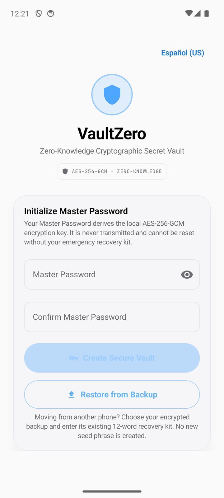
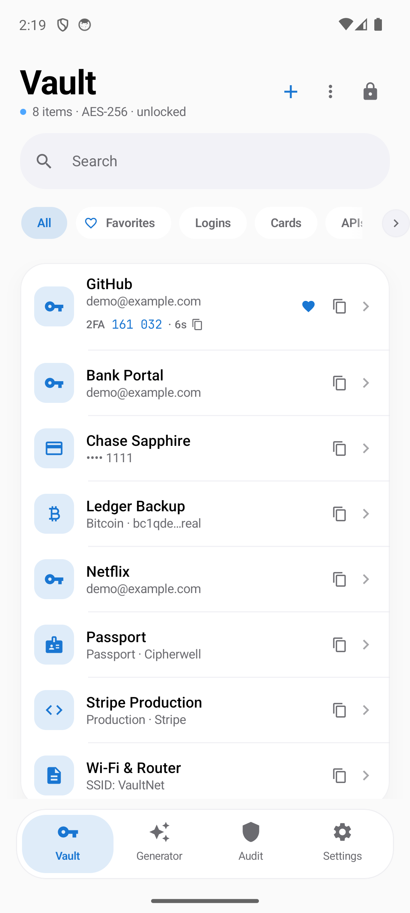
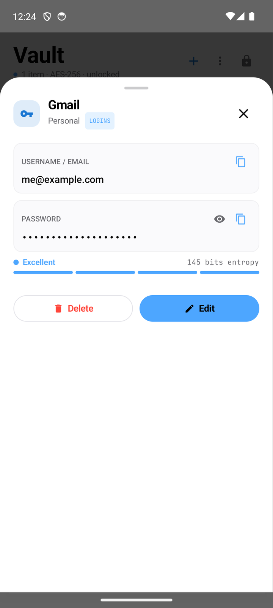
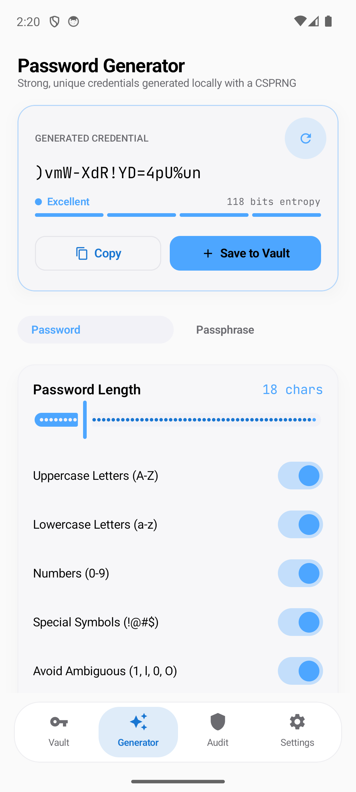
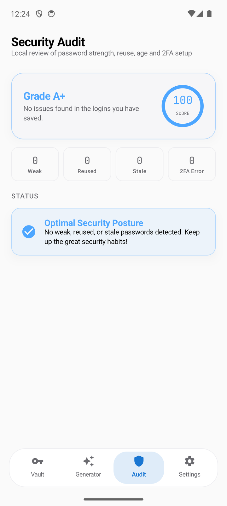
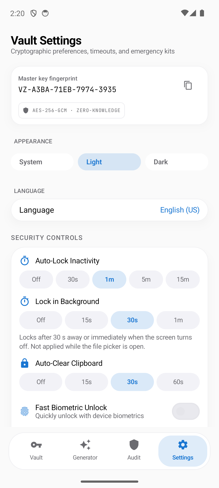
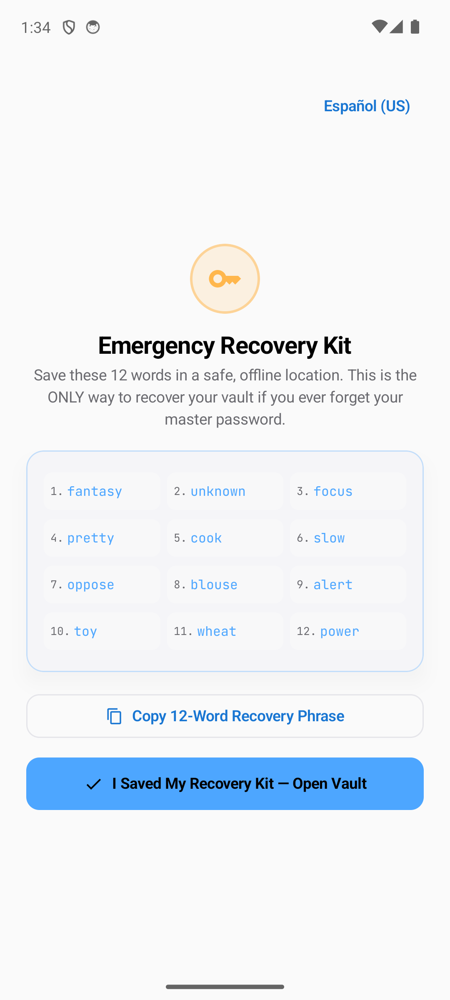
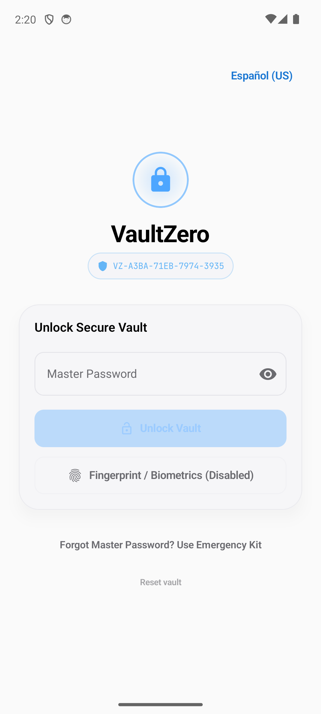

# VaultZero — your private vault

**Beta user guide · v1.7.17 · November 2026**

VaultZero is an offline password vault for Android. It keeps your logins, cards, notes and
recovery codes encrypted on your phone — with **no account, no cloud and no internet permission**.

This guide explains every feature in plain language, shows how the security works, and tells you
exactly what to do (and what to avoid) to keep your vault safe.

---

## Contents

1. What VaultZero is
2. The 60-second version
3. What is inside the app
4. Using every feature
5. How the security works
6. What makes it different
7. What it protects against — and what it cannot
8. Backups and moving to a new phone
9. Installing, updating and verifying
10. Beta notes and the security audit
11. Questions people ask
12. Words explained simply

---

## 1. What VaultZero is

VaultZero is a small, private place for the secrets that keep your digital life running:

- passwords and usernames,
- credit and debit cards,
- API keys and tokens,
- crypto wallet seed phrases and private keys,
- secure notes,
- identity documents.

Everything is encrypted **on your device, before it is stored**. There is no company server to break
into, no account to sign up for, and no "forgot password" email that could be intercepted.

Your **Master Password** is the one key to the vault. It is never stored, never sent anywhere, and
cannot be recovered by anyone — including the developers. That is why the app gives you a **12-word
Recovery Kit** when you first set it up. Keep it offline and safe.

> **The one rule:** if you lose both your Master Password and your Recovery Kit, your vault is gone.
> Nobody can reset it for you. This is the price of true privacy.

---

## 2. The 60-second version

1. **Install** VaultZero from GitHub Releases, Obtainium or the project's F-Droid repository.
2. **Create a vault:** choose a long Master Password (12+ characters is a good target) and confirm it. In a hurry? Tap the **sparkle icon** inside the password field to generate a strong 20-character password, then confirm you saved it.
3. **Save the Recovery Kit:** write the 12 words on paper, in order. Do not photograph it or store it
   in another password app. Keep two copies in two safe places.
4. **Open the vault** (you can enable biometric unlock during setup) and add your first login with the **+** button.
5. **Turn on auto-lock** and, if you like, **biometric unlock** right there on the setup screen (or later in Settings).

That's it. The rest of this guide is detail.



---

## 3. What is inside the app

The app has four tabs at the bottom:

| Tab | What it is for |
| --- | --- |
| **Vault** | Your records: logins, cards, API secrets, wallets, notes and identities |
| **Generator** | Creates strong passwords and passphrases on the device |
| **Audit** | Reviews your saved logins for weak, reused or old passwords and broken 2FA |
| **Settings** | Security, appearance, language, recovery, backup and reset |



### The six record types

When you tap **+ → choose a type**, you get a form tailored to that kind of secret:

| Type | Use it for | Fields you can save |
| --- | --- | --- |
| **Login** | Websites and apps | Username/email, password, website, 2FA secret, private notes |
| **Card** | Credit and debit cards | Cardholder, number, expiry, CVV, ATM PIN, brand |
| **API Secret** | Developer keys and tokens | Service, API key, secret token, environment, scopes, endpoint |
| **Crypto Wallet** | Wallets and seed phrases | Wallet name, network, public address, seed phrase, private key, derivation path |
| **Secure Note** | Anything private | A single encrypted note |
| **Identity** | Passports, IDs, legal documents | Full name, document type and number, birth date, expiry date |

Each record also has a **title**, a **category** (for example Personal or Work) and optional **tags**.

---

## 4. Using every feature

### Add, edit and delete a record

- **Add:** tap **+**, pick a type, fill the fields, then **Save Encrypted**.
- **Edit:** open the record and tap **Edit**.
- **Delete:** open the record, tap **Delete**, or long-press records in the list to select several.
  A deleted batch can be **undone** for a short time — look for the undo bar at the bottom.



### Copy a password or username

Tap the copy icon next to a field. The app copies it, shows a short confirmation, and **clears the
clipboard automatically** after the timer you choose in Settings (or when the vault locks, if you
set the timer to Off). The clipboard copy is marked "sensitive" so Android hides it from clipboard
previews on newer versions.

### Search, filters and favourites

- **Search** looks through titles, usernames, URLs and categories.
- **Filter chips** at the top switch between All, Favourites, Logins, Cards, API Secrets, Crypto
  Wallets, Notes and Identities.
- **★ Favourite** any record with the star. Favourites can be sorted to the top.
- The **⋮ menu** offers sorting (title, recent, recently used) and **group by type**.

### Select several records

Long-press any record to start selection. Tap more records to add them, then use the top bar to
delete the selection or mark it as favourite. Tap the X to leave selection mode.

### Password generator

Open the **Generator** tab:

- **Password mode:** choose length and which characters to use (uppercase, lowercase, numbers,
  symbols), optionally avoid look-alike characters (I, l, 0, O).
- **Passphrase mode:** choose the number of words and the separator; capitalise if you like.
- Tap **Copy**, **regenerate**, or **Save to Vault** to create a login in one step.

The generator uses the phone's secure random number generator. **Session history** shows what you
generated in this session — it lives in memory only and disappears when the vault locks.



### Two-factor (2FA/TOTP) codes

If a website gives you a "setup key" (a Base32 code) for two-factor authentication, paste it into the
**2FA** field of that login. VaultZero then shows a **6-digit code that refreshes every 30 seconds**,
and you can copy it with one tap. Codes are generated on the device; they never travel over the
internet.

The **2FA** chip at the top of the vault opens a dashboard with all your current codes in one place.

### Security check-up (Audit)

The **Audit** tab reviews only your **Login** records and gives you a score and a grade:

| Check | What it means |
| --- | --- |
| **Weak** | The password is short or has low effective entropy |
| **Reused** | The same password is used by more than one login |
| **Stale** | The record has not been updated in more than 90 days |
| **2FA error** | A 2FA secret was entered but is not valid Base32 |

The score starts at 100 and drops for each issue. Grades are **A+ / A / B / C / F**. Each issue has a
**Fix** action that opens the record so you can generate and save a stronger, unique password.



### Settings, row by row



| Setting | What it does |
| --- | --- |
| **Master key fingerprint** | A short public fingerprint of this vault. Safe to share when you need support; it does not reveal the key. |
| **Appearance** | System, Light or Dark theme. |
| **Language** | English or Spanish, independent of the phone language. |
| **Auto-Lock Inactivity** | Locks after 30 s, 1, 5 or 15 minutes without interaction. |
| **Lock In Background** | Locks 15 s, 30 s or 1 minute after you leave the app; also locks when the screen turns off. |
| **Auto-Clear Clipboard** | Clears copied secrets after 15, 30 or 60 seconds, or on lock when set to Off. |
| **Fast Biometric Unlock** | Unlock with fingerprint/face instead of typing the Master Password. |
| **Change Master Password** | Re-wraps the vault key with a new password. Your records and Recovery Kit stay valid. |
| **Lock Vault Now** | Locks immediately. |
| **View Recovery Kit** | Shows the 12-word phrase after you re-enter the Master Password. |
| **Replace Recovery Kit** | Creates a new 12-word phrase. The old phrase stops working for this vault — export a new backup afterwards. |
| **Export Encrypted Vault Backup** | Writes an encrypted JSON file to a location you choose. |
| **Restore / Import Encrypted Backup** | Imports records from a backup, with verification before anything is written. |
| **Cryptographic Specifications** | The exact algorithms and protections in the app. |
| **Copy Diagnostics** | A support report with version, device, language, vault state and error — never secrets. |
| **Erase Vault Completely** | Deletes records, keys and passwords from this device. Irreversible. |

### The Recovery Kit (12 words)

When the vault is created, the app shows a 12-word phrase:

- Write it **on paper**, in order, and keep it offline.
- It is the only way back in if you forget the Master Password.
- Anyone with the phrase can open your vault — treat it like the key to your house.
- In **Settings → View Recovery Kit** you can see it again after confirming the Master Password.



### Unlock and biometrics



- Type the Master Password and tap **Unlock Vault**.
- If **Fast Biometric Unlock** is enabled, the system prompt appears **automatically each time you open the app** (and after auto-lock); you can also tap the fingerprint/face button.
- After several wrong attempts the app pauses for a short cooldown.
- Biometrics only unlock the copy of the vault key wrapped by the phone's secure hardware
  (Keystore). If you add or remove a fingerprint in Android settings, that key is invalidated and you
  must unlock once with the Master Password and re-enable biometrics.

### Restore after forgetting the Master Password

1. Tap **Forgot Master Password? Use Emergency Kit**.
2. Enter the 12-word phrase.
3. Choose a new Master Password.
4. The vault key and all records are recovered; the old Master Password stops working.

---

## 5. How the security works

You do not need to understand the maths to use VaultZero, but here is the honest, simple version.

### One password, one key, no storage

- Your **Master Password** is turned into a strong encryption key on the phone using **Argon2id**, a
  deliberately slow function (64 MiB of memory, 3 passes). A random **salt** makes precomputed attacks
  useless.
- The password itself is **never stored**. The app keeps only a one-way verifier that can check a
  password but cannot reveal it.
- The actual vault key (the key that encrypts your records) is stored **wrapped** (encrypted) by the
  key derived from your password — and separately by your Recovery Kit.

### Every record is sealed individually

- Each record is encrypted with **AES-256-GCM**, an authenticated cipher. It protects both secrecy and
  integrity: if even one bit of a record is altered, decryption fails instead of returning bad data.
- Every record uses a **unique 12-byte IV** (a one-time number) and a 128-bit authentication tag.
- Each record is **bound to its identity** (ID and type) through additional authenticated data, so
  ciphertext cannot be silently moved from one record to another.
- Record titles, categories, tags and the payload are encrypted **together**. The database stores only
  a harmless placeholder like `[ENCRYPTED]`. (The item type and timestamps remain as non-secret
  metadata.)

### The phone protects the key

- **Biometric unlock** uses a key that lives in the phone's **Keystore** (TEE/StrongBox) and requires a
  fresh fingerprint/face check for every use. The key is invalidated if biometrics are re-enrolled.
- **Auto-lock** clears the in-memory key after inactivity, on background or when the screen turns off.
- **Screenshots are blocked** with `FLAG_SECURE`; the app is also hidden from the Recent Apps preview.
- **Clipboard secrets** are marked sensitive and cleared on a timer or on lock.
- **Taps through overlays** are ignored, which limits tapjacking by another app drawing on top.

### No network means no cloud breach

- The packaged app **does not have the INTERNET permission**. It cannot send your data anywhere, even
  if it wanted to.
- There is **no account, no sync server and no telemetry**. No analytics SDKs, no crash reporters, no
  ads.
- **Backups are excluded** from Android cloud backup and device-to-device transfer. The only way data
  leaves the app is an encrypted backup **you** export to a file you choose.

### Why the Recovery Kit matters

The vault key is also wrapped with a key derived from your 12-word **BIP-39** phrase (128 bits of
entropy, with a checksum). That phrase is the portable backup of last resort: with it you can open
the vault on a new phone even if you forgot the password.

---

## 6. What makes it different

| | Typical cloud password manager | VaultZero |
| --- | --- | --- |
| Where secrets live | Company servers + your devices | Only your device |
| Account required | Yes (email, often phone) | No |
| Internet permission | Yes | **No** |
| Cloud breach can expose vaults | Possible | No cloud to breach |
| Telemetry / analytics | Usually some | None |
| Open source | Rarely | Yes (MIT) |
| Sync between devices | Automatic | Manual encrypted backup |
| Recovery | Email/reset link | 12-word kit you hold |
| Battery/network use | Background sync | Zero |

**The trade-off is deliberate:** you give up automatic sync and "reset my password by email" in
exchange for a much smaller attack surface and no company that can be breached, subpoenaed or shut
down. One device, one encrypted file, one password — and a paper kit that only you control.

---

## 7. What it protects against — and what it cannot

**It is designed to protect you from:**

- someone stealing your phone and trying to read the vault,
- another app reading your screen, clipboard or Recent Apps preview,
- a malicious backup file trying to crash or trick the importer,
- a cloud service breach or an account takeover,
- a nosy person picking up your unlocked phone (auto-lock).

**It cannot protect you from:**

- **malware or a keylogger** on your phone, including a compromised keyboard,
- a **weak or reused Master Password** — Argon2id slows guessing, but it cannot fix a bad password,
- a **rooted or physically compromised device** where an attacker can inspect a running app,
- **losing your Recovery Kit** (the data is then unrecoverable),
- someone forcing you to unlock the vault,
- screenshots taken with another camera pointed at your screen.

No app can promise perfect security. VaultZero's promise is narrower and honest: your secrets stay
encrypted on your device, and no server of ours can leak them.

---

## 8. Backups and moving to a new phone

### Export a backup

1. **Settings → Export Encrypted Vault Backup.**
2. Choose how the file can be opened:
   - **Master password or recovery phrase** — the friendliest option for moving phones.
   - **12-word recovery phrase only** — the password envelope is removed; only the phrase opens it.
3. Pick a file location and save. The file is an **encrypted JSON envelope**; it is useless without
   the chosen credential.

Store backups on a trusted drive, not in a public folder or chat. Treat a phrase-only backup as
strictly as the paper kit.

### Restore on a new phone

1. Install VaultZero and choose **Restore from backup** on the first screen (or **Settings → Restore /
   Import Encrypted Backup** if a vault already exists).
2. Pick the backup file.
3. Enter the source vault's **Master Password or its 12-word Recovery Kit**.
4. The app verifies every record **before writing anything**. A partial or corrupted file is rejected,
   not half-imported.
5. If you are restoring onto a fresh install, you may be asked to set a new Master Password.

Biometrics are device-bound: they unlock the vault on *this* phone only and cannot open a foreign
backup.

---

## 9. Installing, updating and verifying

VaultZero is **not on Google Play** on purpose: fewer middlemen, no Play Services, no account.

- **GitHub Releases** — download `VaultZero-vX.Y.Z.apk` and its `.sha256` file.
- **Obtainium** — add the GitHub repository URL to receive updates from the releases feed.
- **F-Droid repository** — add the project's self-hosted repo URL in F-Droid to install and update.

Verify a download before installing:

```bash
sha256sum -c VaultZero-vX.Y.Z.apk.sha256
apksigner verify --print-certs VaultZero-vX.Y.Z.apk
```

Every release publishes its SHA-256 and signing certificate fingerprint. The app requires Android
7.0 or newer.

---

## 10. Beta notes and the security audit

VaultZero is in **beta**: the features in this guide are complete, but you should keep independent
backups and expect rough edges.

Before this beta, the app went through a full **security audit and penetration test** (OWASP MASVS
2.1): static review, on-device checks, storage inspection, crypto review, a malformed-backup fuzz
corpus and a full test suite.

- **No Critical or High findings.**
- **Two Medium denial-of-service bugs** in the backup importer were found and fixed before release
  (an unbounded read and a deep-JSON stack overflow). Regression tests cover both.
- **137 automated tests / 0 failures**, lint clean; **15/15 on-device instrumentation tests** on a
  Pixel 9 Pro XL, including biometric key binding.
- The full report is in `docs/security/AUDIT-2026-11-21.md` in the repository.

Remaining known hardening items are documented in that report (KDF floor for restored legacy
backups, restore atomicity). Neither exposes vault contents; both are scheduled for the next release.

---

## 11. Questions people ask

**I forgot my Master Password. What now?**
Use **Forgot Master Password? Use Emergency Kit** and your 12 words. Without the kit, the vault
cannot be recovered — that is the security model.

**Can the developers recover my vault?**
No. There is no server, no account and no backdoor. The app cannot send data anywhere (no internet
permission).

**What happens if I lose my phone?**
Your vault stays encrypted on the device. Restore your latest backup on a new phone with the Master
Password or Recovery Kit and continue.

**Do I need to back up?**
Yes, if you care about the data. The vault does not sync. Export an encrypted backup regularly and
store it safely.

**Why does biometric unlock stop working after I add a fingerprint?**
Android invalidates auth-bound Keystore keys when biometrics change, by design. Unlock with the
Master Password and re-enable biometrics.

**Does it work offline?**
Always. It never needs a connection.

**Is it free? Is it open source?**
Yes. The project is MIT-licensed and the source is public, so anyone can inspect what it does.

**Can I use it on my tablet and phone?**
Yes — as two separate vaults, or by restoring the same encrypted backup on both. Changes are not
merged automatically.

**What is the Master key fingerprint for?**
It identifies a vault (for support or comparing two devices) without revealing any secret.

---

## 12. Words explained simply

| Term | Meaning |
| --- | --- |
| **Master Password** | The one password you remember. It unlocks everything and is never stored. |
| **Vault key** | A long random key that encrypts your records. It is stored wrapped by your password and your Recovery Kit. |
| **Encryption** | Scrambling data so only someone with the key can read it. |
| **AES-256-GCM** | A modern, authenticated encryption standard. "Authenticated" means tampering is detected. |
| **Argon2id** | A slow, memory-hard function that turns a password into a key, making guessing expensive. |
| **Salt** | Random data added to a password before hashing so precomputed attacks do not work. |
| **Keystore / TEE / StrongBox** | Secure hardware inside the phone that can hold keys the app cannot export. |
| **Biometrics** | Fingerprint or face unlock. |
| **TOTP / 2FA code** | The 6-digit code that changes every 30 seconds. |
| **Recovery Kit** | Your 12-word phrase, the last-resort way to recover the vault. |
| **Encrypted backup** | A file with your encrypted vault, exported only when you ask. |
| **FLAG_SECURE** | Android's "no screenshots / no screen recording" flag. |

---

## Privacy in one sentence

VaultZero keeps your secrets encrypted on your phone, gives them to nobody, and asks you to keep one
strong password and one paper Recovery Kit safe.

*Questions, bugs or beta feedback: open an issue on the GitHub repository. Do not paste real secrets
into an issue.*
