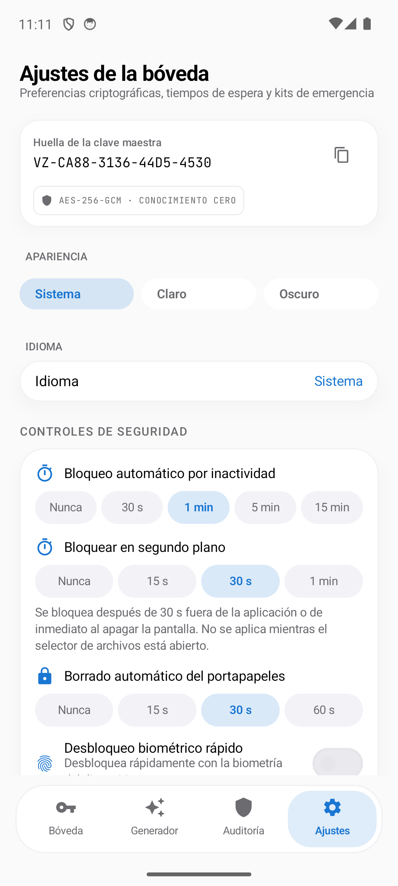
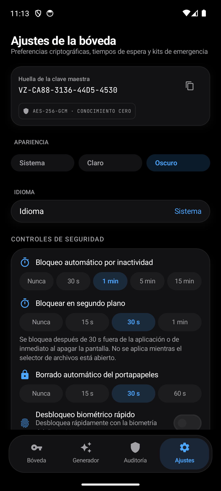

# 🛡️ VaultZero `v1.7.11` — subtle elevation

**Release date:** 21 November 2026
**Package:** `com.cipherwell.vaultzero` · **versionCode:** 20
**Min SDK:** 24 · **Target/compile SDK:** 36 · **License:** MIT

Every panel now separates from the background, without any heavy chrome.

## What changed

- **One container for every card.** `VaultCard` replaces 19 direct `Card` call sites across 8
  screens (vault list, settings, generator, audit, item editor, item detail, TOTP, lock/recover).
- **Light theme:** 10 dp soft drop shadow (ambient black 10%, spot black 16%) — reads on `#FAFAFA`.
- **Dark theme:** 9 dp white rim (12% / 18%). A black shadow is invisible on `#000000`, so separation
  comes from a faint halo: measured **≈6/255** at the card edge, fading over ~35 px. Visible as a
  edge, not a glow.
- **Borders stay primary:** the existing 1 dp hairline (55% outline) is unchanged, so nothing looks
  inflated.
- **Deliberately unshadowed:** buttons, chips, list rows, the bottom bar and the search field.

## Verification

- Captured with a **QA-only build** (`-PallowScreenshots=true`); the shipped APK keeps
  `FLAG_SECURE` on, confirmed by a 0-byte `adb screencap` after installing the release build.
- Shadows measured in pixels: card edge lift 6/255 in dark; light shadow visible under each card.
- **131 JVM/Robolectric tests / 0 failures**, lint 0 errors.

## ⬇️ Downloads

| Asset | Size | SHA-256 |
| --- | ---: | --- |
| [`VaultZero-v1.7.11.apk`](https://github.com/cipherwell/Vault-Zero/releases/download/v1.7.11/VaultZero-v1.7.11.apk) | 2,206,757 B | `4ea4dbdba3f7eb8a94e8f3c92635f781a02ac58a781820cc5e16fecc1a7031d0` |
| checksum file | — | `VaultZero-v1.7.11.apk.sha256` |

Signing certificate (Cipherwell upload key, APK Signature Scheme v2):
`6292a1fc630c200e7ec5342248ba7a6ae30a893fd882b2ad4188f699bbb607e7`

Updates without Google: `https://cipherwell.github.io/Vault-Zero/fdroid/repo`
(fingerprint `BC:CC:45:55:…:F9:49`) or Obtainium.
