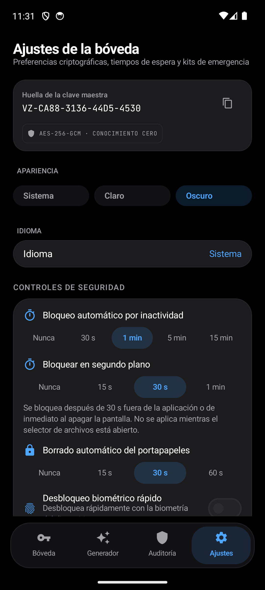
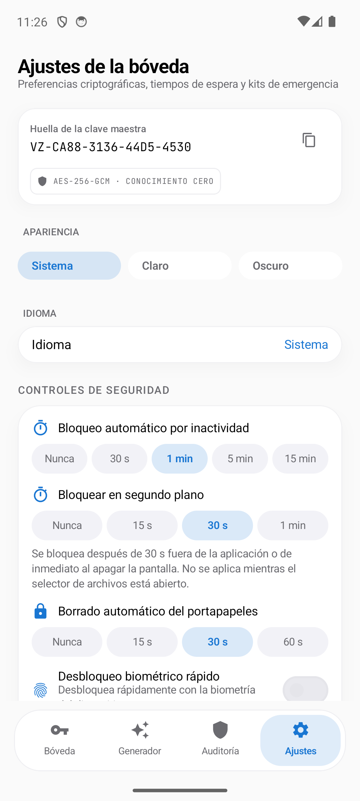

# 🛡️ VaultZero `v1.7.12` — grey cards, no dark shadows

**Release date:** 21 November 2026
**Package:** `com.cipherwell.vaultzero` · **versionCode:** 21
**Min SDK:** 24 · **Target/compile SDK:** 36 · **License:** MIT

Two fixes from the 1.7.11 elevation pass.

## Dark mode: grey, opaque, shadow-free

- **Cards are `surfaceContainerHigh` `#1C1C1E`** — measured `(28, 28, 30)` on-device. They no longer
  inherit the caller's `surface`/translucent container, which is what made the lock card look navy
  against the black ground.
- **No shadows in dark mode at all.** On true black they were invisible at best, and the white rim
  could show through a translucent card and stamp the shadow layer's bounds as a grey rectangle.
- Separation now comes from the lifted grey surface plus the 1 dp hairline border — the One UI cue.

## Light mode unchanged

- White/grey containers, soft 10 dp drop shadow (ambient black 10%, spot black 16%).
- Card containers are composited opaque, so the shadow can never bleed through a translucent card.

## Verification

- Captured with a QA build (`-PallowScreenshots=true`); shipped APK keeps `FLAG_SECURE`.
- Pixel-sampled: dark card `(28,28,30)`, no rectangle, no tint; light card shadow present.
- **131 JVM/Robolectric tests / 0 failures**, lint 0 errors.

## ⬇️ Downloads

| Asset | Size | SHA-256 |
| --- | ---: | --- |
| [`VaultZero-v1.7.12.apk`](https://github.com/cipherwell/Vault-Zero/releases/download/v1.7.12/VaultZero-v1.7.12.apk) | 2,206,757 B | `5a9a6e179889f6e8fc43bc762d3054b42f7b431b4d7fcde446ac6f627ac9f6bb` |
| checksum file | — | `VaultZero-v1.7.12.apk.sha256` |

Signing certificate (Cipherwell upload key, APK Signature Scheme v2):
`6292a1fc630c200e7ec5342248ba7a6ae30a893fd882b2ad4188f699bbb607e7`

Updates without Google: `https://cipherwell.github.io/Vault-Zero/fdroid/repo`
(fingerprint `BC:CC:45:55:…:F9:49`) or Obtainium.
